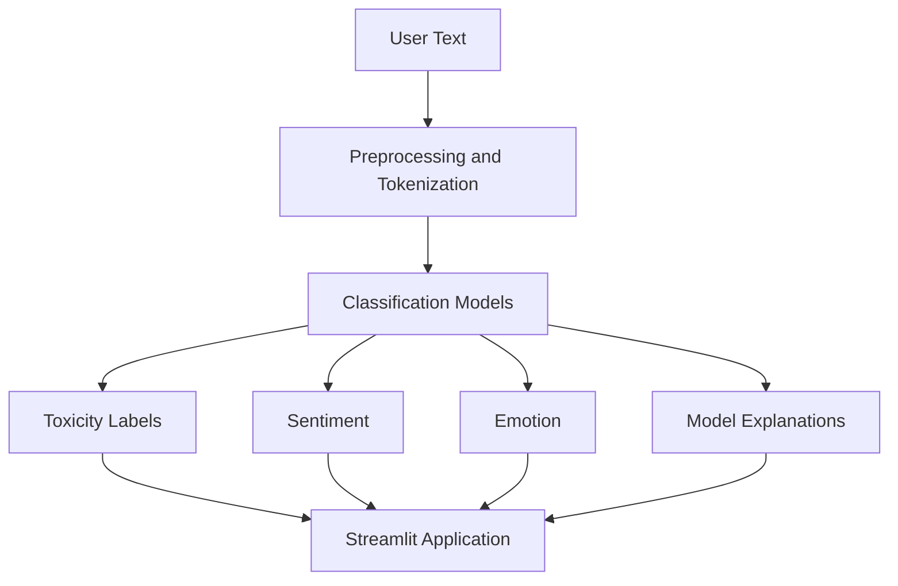

# OpenTrust AI — Toxic Comment Classification

A natural-language processing project for analyzing user-generated text across three related tasks: multi-label toxicity detection, sentiment classification, and emotion classification.

**Live demo:** [Open the Streamlit app](https://toxiccommentclassification-rmtl389tpzbgx3mcgwjfca.streamlit.app/)

> **Responsible-use note:** Automated text classification can be wrong and may reflect dataset or model bias. Treat predictions as decision support; provide human review and an appeal path before taking moderation action.

## What it explores

- **Toxicity classification:** Multi-label prediction for toxic, severe toxic, obscene, threat, insult, and identity-hate categories.
- **Sentiment analysis:** Positive, neutral, and negative sentiment.
- **Emotion analysis:** Emotion categories such as joy, anger, fear, sadness, surprise, disgust, and neutral.
- **Explainability:** SHAP/LIME-style feature attribution to help inspect model behaviour.
- **Interactive application:** Streamlit interface for exploring predictions, analysis, and model results.

## Architecture



## Technology stack

Python · Pandas · scikit-learn · PyTorch · Hugging Face Transformers · DistilBERT · Streamlit · SHAP · LIME · Docker

## Model evaluation

The project compares classical machine-learning, deep-learning, and transformer approaches. The repository includes a model leaderboard; consult the evaluation artifacts and rerun the experiments to reproduce reported metrics. Metrics are dataset- and split-specific and should not be interpreted as guaranteed real-world performance.

## Run locally

The repository's current quick-start uses the deployment folder:

```bash
git clone https://github.com/Abishek412001/Toxic_comment_classification.git
cd Toxic_comment_classification
pip install -r deployment/requirements.txt
streamlit run dashboard/app.py
```

If you are using a different branch or folder layout, check the repository tree and use the matching requirements and application paths.

## Project structure

- `dashboard/` — Streamlit application
- `deployment/` — Runtime dependencies and deployment configuration
- `tests/` — Automated tests
- Model and analysis modules — preprocessing, inference, and evaluation

## Author

**Abishek** · [GitHub profile](https://github.com/Abishek412001)
